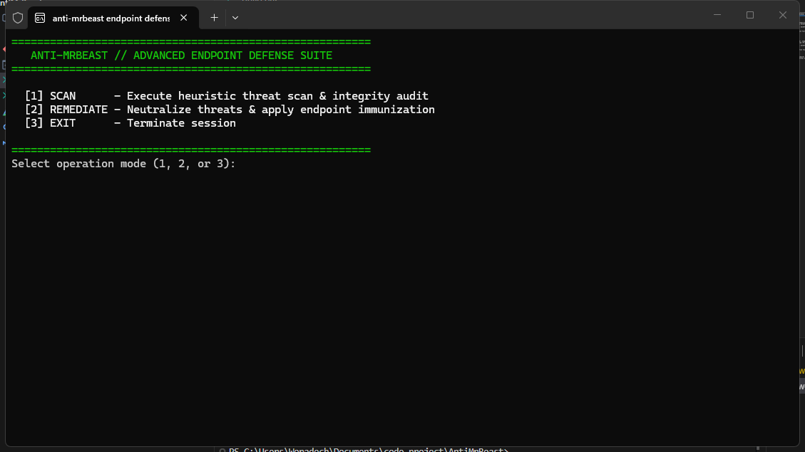

# AntiMrBeast

<p align="left">
  <a href="README.md"></a>
  <a href="README.th.md"></a>
</p>

เครื่องมือตรวจสอบความสมบูรณ์ของระบบ (Endpoint Integrity Scanner) และแก้ไขภัยคุกคามสำหรับ Windows พัฒนาด้วย C++ แบบ Native มุ่งเป้าตรวจจับสายการทำงานของสคริปต์ต้องสงสัย, ไฟล์ Dropper และช่องทางฝังตัวใน Build-Chain



## ความสามารถหลัก

- **ตรวจสอบ Script Host**: ตรวจจับโพรเซส `wscript.exe` และ `cscript.exe` ที่รันอย่างผิดปกติในระบบ
- **ตรวจจับ Dropper**: สแกนไดเรกทอรี `%LOCALAPPDATA%` เพื่อค้นหาร่องรอยของไฟล์มัลแวร์ที่ตรงกับแพทเทิร์น `BK*.exe`
- **ตรวจสอบการฝังตัว**: สแกนโฟลเดอร์ build-chain (`%LOCALAPPDATA%\Microsoft\MSBuild`) เพื่อหาไฟล์ที่อาจถูกใช้เป็นช่องทางคงสถานะ (Persistence)
- **จัดการภัยคุกคามอัตโนมัติ**: ยุติโพรเซสสคริปต์ที่ผิดปกติ, ปิดการทำงานของ Windows Script Host ผ่าน Registry Policy, กำจัดไฟล์ Dropper และลงทะเบียนกฎ Software Restriction Policies (SRP) เพื่อบล็อกการรันซ้ำ

## การคอมไพล์ (Build)

ความต้องการ: Windows 10/11 (x64) และคอมไพเลอร์ C++17 (`g++` หรือ `MSVC`)

```bat
build.bat
```

หรือคอมไพล์โดยตรงผ่านคำสั่ง:

```bash
g++ -std=c++17 -O2 main.cpp -o AntiMrBeast.exe
```

## การใช้งาน

รัน `AntiMrBeast.exe` ในฐานะ Administrator (ระบบจะขอสิทธิ์ UAC อัตโนมัติหากยังไม่ได้รับสิทธิ์):

| ตัวเลือก | โหมด | การทำงาน |
| :--- | :--- | :--- |
| `1` | **SCAN** | สแกนโพรเซส, ไฟล์ในระบบ และ Registry เพื่อค้นหาภัยคุกคามแบบอ่านอย่างเดียว (Read-only) |
| `2` | **REMEDIATE** | ยุติโพรเซสต้องสงสัย, ปิด WSH, บังคับใช้นโยบาย SRP และล้างโฟลเดอร์แคชของมัลแวร์ |
| `3` | **EXIT** | ปิดเธรดการทำงานเบื้องหลังและออกจากโปรแกรม |

## การนำไปพัฒนาต่อ (Open Source & Contributions)

โปรเจกต์นี้เปิดเป็น Open Source ทุกคนสามารถนำ Source Code ไปศึกษา ดัดแปลง เพิ่มฐานข้อมูล Signature หรือนำไปต่อยอดและพัฒนาต่อได้ 100% อย่างอิสระ ไม่ว่าจะเป็นการเพิ่มขอบเขตการตรวจจับหรือนำไปประยุกต์ใช้กับระบบรักษาความปลอดภัยอื่นๆ

## ข้อจำกัดความรับผิดชอบ (Disclaimer)

เครื่องมือนี้ทำงานโดยอ้างอิงจากตัวบ่งชี้ภัยคุกคาม (IOCs), รูปแบบชื่อไฟล์ และเส้นทางการฝังตัวที่ระบุไว้เฉพาะ หากผู้ไม่หวังดีมีการอัปเดตตัวมัลแวร์ เช่น เปลี่ยนรูปแบบการตั้งชื่อไฟล์, เปลี่ยนโฮสต์ในการรันสคริปต์ หรือเปลี่ยนไดเรกทอรีในการจัดเก็บ อาจส่งผลให้ระบบไม่สามารถตรวจจับตัวแปรใหม่ (Variants) ได้ เครื่องมือนี้จึงเหมาะสำหรับใช้เป็นมาตรการเสริมเฉพาะจุด และไม่สามารถทดแทนโซลูชันความปลอดภัยระดับ Endpoint (EDR/Antivirus) เต็มรูปแบบได้
